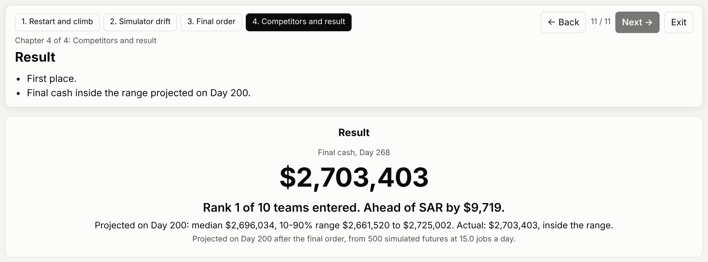
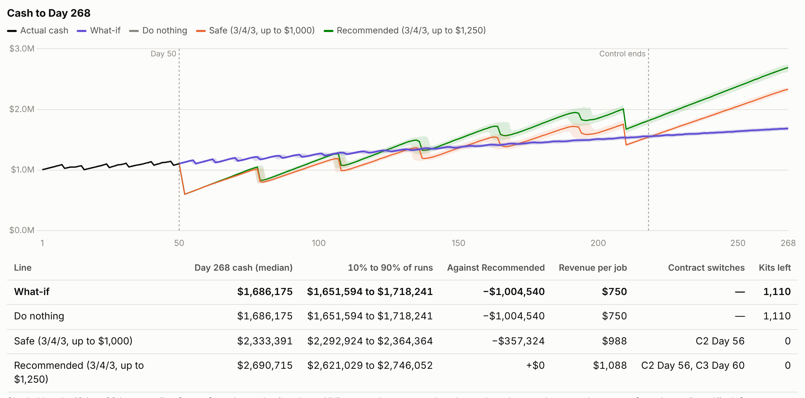
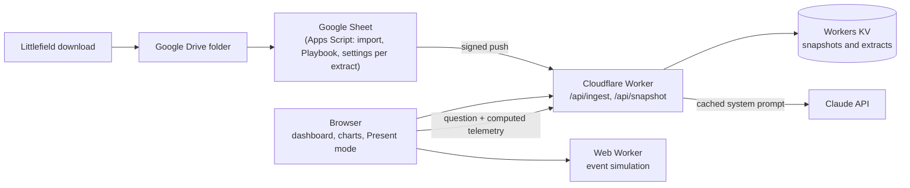
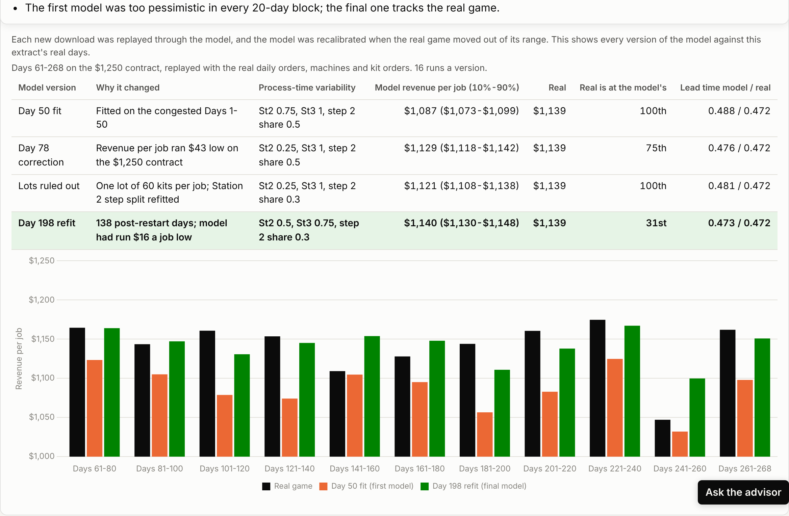
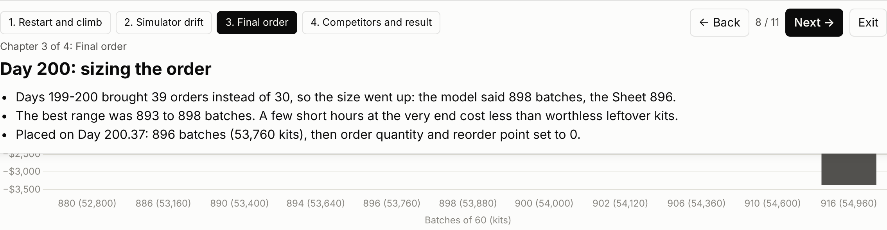

# Littlefield Simulation 2: operations dashboard

A decision-support dashboard built by the **A Team** for Littlefield, the factory
simulation used in MBA operations courses. It turned the game's daily downloads into a
live view of the factory, tested decisions in a calibrated simulation before they were
made, and explained the numbers through an AI advisor.

**Result: first place of 11 teams, with $2,703,403 in final cash**, $9,719 ahead of
second. The final figure landed inside the range the simulator projected on Day 200
(median $2,696,034, within 0.3%).



## The problem

Each team runs a small electronics factory for 268 simulated days, one day per real
hour, and is judged on its cash at the end. Orders arrive at random, every job passes
through three stations (one of them twice), kits take four days to arrive, and the
contract you choose pays $750, $1,000 or $1,250 a job depending on how fast the job is
finished. On Day 218 the controls lock and the factory runs on its last settings.

We took over on Day 50 with an overloaded factory: three stations at or near full
load, 68 jobs in progress, lead times over four days and repeated kit stockouts.

## What the system did

| Decision | How the dashboard supported it | What happened |
|---|---|---|
| Restart on Day 51 | Cash projections to Day 268 for each machine mix and contract, as medians of 200 simulated futures with 10-90% bands | Bought to 3/4/3, raised kit orders from 7,200 to 26,700, moved from $750 to $1,000 (Day 56) and $1,250 (Day 61) as lead times fell under half a day |
| Keep the model honest | Each new download replayed through the model; recalibrated four times when the real game left the model's range | The final model matched the real revenue per job over Days 61-268 ($1,140 against $1,139) |
| Final kit order | A simulator sweep of the order day and size, and a check of when Littlefield's automatic reorder would fire | 896 batches (53,760 kits) placed on Day 200.37; no stockout afterwards, and 380 kits (about $3,800) left over at the end |
| Competitors | Leaderboard cash over time, cash-per-day patterns that reveal each team's contract, purchase detection | Tracked through the game |



*From the Day 50 data: doing nothing against the two restart plans. Each line is the
median of 200 simulated futures.*

## How it works



- **Google Sheet as the source of truth.** An Apps Script imports each download from a
  Drive folder, computes the team's Playbook (reorder point, machines, contract, final
  order), and pushes a signed JSON snapshot to the Worker. An Extracts tab keeps every
  download with the settings that were in force on its day, so any point in the game can
  be shown again.
- **Event simulation, twice.** A discrete-event model of the factory (Poisson orders,
  four-step routing, the three Station 2 scheduling rules, the four Littlefield
  conditions for a kit order, contract pricing, interest, the Day 218 lock) is written in
  Python as the reference and ported line by line to JavaScript for the browser. Both use
  the same seeded random number generator, and the tests check that every simulated day
  matches between them.
- **Calibration against the real game.** Process times are measured from utilization;
  their variability is fitted by replaying the real daily orders, machine purchases and
  kit orders through the model. The drift panel shows every version of the model against
  the real days.
- **An advisor that explains, not calculates.** The browser computes every figure and
  sends it with the question. The Worker adds a fixed, cached system prompt and calls
  Claude, which is told to quote only those figures and to defer to the Playbook. Answers
  stream into a drawer; a daily token budget caps the cost, and every question and answer
  was logged for the course's AI-use disclosure.
- **Present mode** walks through the story in four chapters (restart, simulator drift,
  final order, competitors and result), loading the right extract for each step.





## Engineering notes

- No framework and no build step for the site: plain ES modules and Chart.js, a strict
  Content Security Policy, and the simulation runs in a Web Worker so 200-run projections
  (about 1.5 seconds) do not block the page.
- Security: During the simulation, the team had Cloudflare Access in front of the whole site, with the Worker also verifying
  the Access token on the advisor; the ingest route takes a shared secret compared in
  constant time; secrets live only in Cloudflare; a portfolio mode makes the deployment
  read-only and replaces the live advisor with saved answers.
- Tests: 33 in Node (Worker routes, extract storage, calculations, the JavaScript
  simulator against the Python reference, the advisor with the Claude API replaced by a
  local stand-in) and 35 in Python (factory rules, the four kit-order conditions,
  calibration against Days 1-50, 61-78 and 61-198, the final-order sizing).

| Layer | Technology |
|---|---|
| Hosting | Cloudflare Workers with static assets, Workers KV, Cloudflare Access |
| Data pipeline | Google Drive, Google Sheets, Google Apps Script |
| Front end | HTML, CSS and JavaScript modules, Chart.js 4.4.7, Web Workers |
| Simulation | Python 3 (standard library only) and a JavaScript port |
| Advisor | Claude Sonnet 5.5 through the Anthropic TypeScript SDK, streaming, prompt caching |

## Run it locally

Node 18 or later. No accounts are needed: the preview server loads the game's
downloads from `test/fixtures/` and answers advisor questions with a canned reply.

```bash
npm install
npm test
npm run preview          # http://localhost:8788, then press Present
```

The Python model:

```bash
cd sim && python3 -m unittest discover -s tests
python3 -m littlefield validate ../test/fixtures/day198.json
```

Deployment, the Sheet setup and the presentation workflow are in
[docs/OPERATIONS.md](docs/OPERATIONS.md); the model and its calibration in
[sim/README.md](sim/README.md).

## Repository

| Path | Contents |
|---|---|
| `public/` | The dashboard: telemetry, what-if simulator, advisor drawer, panels, Present mode (`story.js` holds its text) |
| `public/sim/` | JavaScript event simulation, replay and analyses, run in a Web Worker |
| `src/` | Cloudflare Worker: ingest, snapshots and extracts, advisor endpoint, Access verification |
| `apps-script/` | The Google Sheet's script |
| `sim/` | Python reference model, calibration and command-line tools |
| `test/` | Node tests, game downloads as fixtures, Python reference results, local preview server |
| `docs/` | Operating guide and screenshots |

## How it was built

The A Team designed the approach, ran the factory, and made every decision in the game.
The code (dashboard, Worker, Apps Script, full Python model and tests) was written by Claude
(Anthropic) in Claude Code and Cowork sessions, directed and reviewed by the team. The Python model 
was originally built by the team as an MVP from the game's rules and specifications. The
advisor's answers during the game were written by Claude Sonnet from the dashboard's
numbers, and disclosed to the course with the full log.

Littlefield is a product of Responsive Learning Technologies; this project is not
affiliated with it. The game data in `test/fixtures/` comes from our own team's
downloads.

## License

[MIT](LICENSE). Chart.js, included in `public/vendor/`, is also MIT-licensed and keeps
its own notice.
